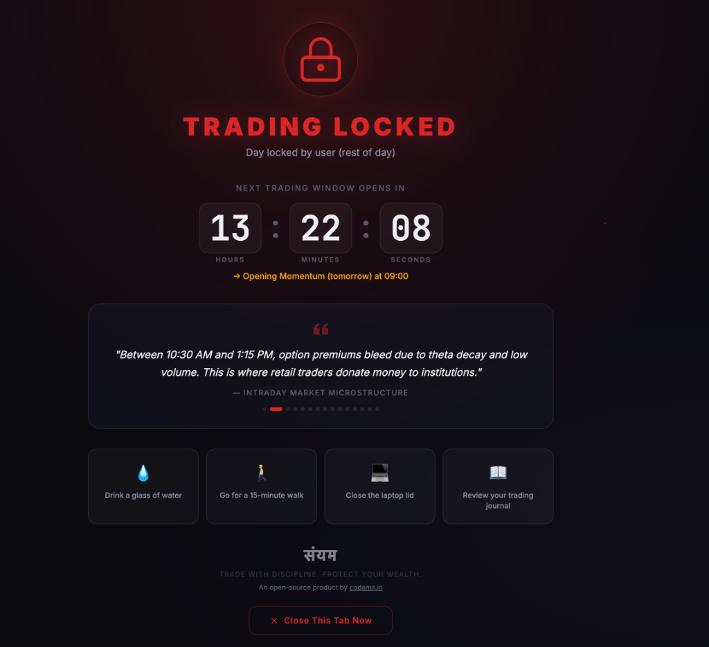
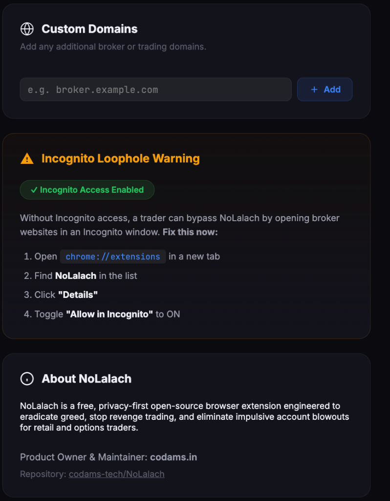
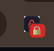
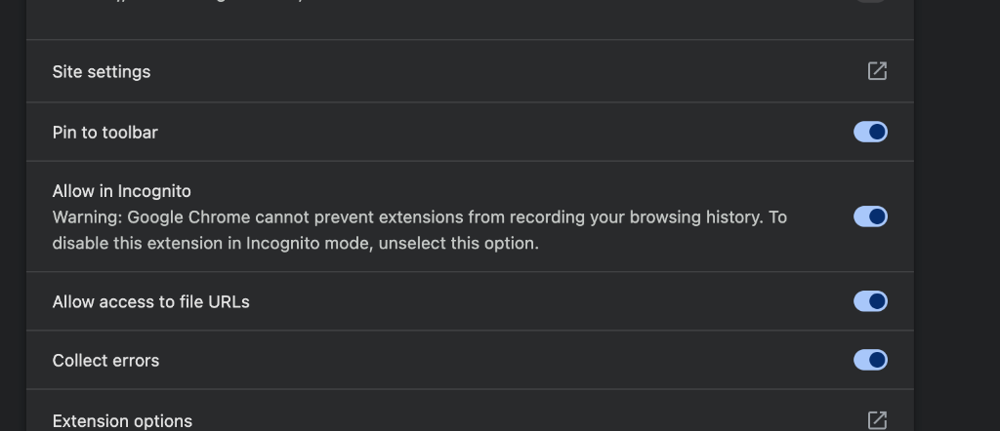

<p align="center">
  
</p>

<h1 align="center">NoLalach: Anti-Overtrading & Discipline Blocker</h1>
<h3 align="center">NoLalach (नो लालच) — "No Greed. Pure Discipline. Protect your wealth."</h3>

<p align="center">
  <strong>An open-source product by <a href="https://codams.in">codams.in</a></strong>
</p>

<p align="center">
  
  
  
  
  
  
</p>

---

## 📸 Product Previews & Live Screenshots

### 1. High-Friction Redirection Lockout Screen
When a trader attempts to visit broker websites during non-trading hours (e.g. 10:30 AM – 1:15 PM chop zone) or after hitting daily trade limits, the request is intercepted before render and redirected to this high-friction lockout screen with session countdown, 4-7-8 breathing guidance, and psychology quotes:

<p align="center">
  
</p>

### 2. Live Toolbar Popup & Session Monitor
Clicking the NoLalach icon in the browser toolbar provides real-time market status, countdown timer to the next trading session, a live daily trade counter, 1-click working hours adjustment, and one-click "Lock Rest of Day" control:

<p align="center">
  
</p>

### 3. Allowed Trading Hours, Presets & 5-Minute Warning Alert
Easily configure allowed trading windows to match your trading style. One-click preset chips allow instant switching between Indian F&O, Full Day Session, Morning Only, or US Markets. Configure the 5-minute pre-lock desktop alert and toggle supported broker websites:

<p align="center">
  
</p>

### 4. Anti-Tampering Strict Mode & Circuit Breaker
During market hours, impulsive traders are blocked from altering settings without a mandatory 15-minute cooldown timer and psychological pledge typing test. Also configure weekend locking and daily trade limits:

<p align="center">
  
</p>

### 5. Custom Domains & Incognito Safeguard Status
Add any custom broker or prop-firm trading terminal. The built-in Incognito monitor actively audits whether private-browsing access is enabled, preventing traders from bypassing lockouts:

<p align="center">
  
</p>

---

## 🎯 The Problem: Why Traders Blow Accounts

Traders don't blow accounts because they don't know the rules. They blow accounts because **in high-cortisol, impulse-driven moments**, they break every rule they've set for themselves.

### The Three Account Killers

| Killer | What Happens | NoLalach's Solution |
|--------|-------------|----------------------|
| **Chop Zone Trading** (10:30 AM – 1:15 PM) | Low volume, theta decay, false breakouts trap retail option buyers. Institutions accumulate while retailers bleed premiums. | **Time-based lockout** — broker websites redirect to a locked screen during non-trading hours |
| **Revenge Trading** | A ₹2,000 loss turns into ₹50,000 as the trader takes 10–20 impulsive trades trying to "recover" | **Daily trade counter + circuit breaker** — lock all brokers after max trades are exhausted |
| **Disabling Blockers** | Stressed traders with basic tech knowledge disable extensions, delete overlay divs, or open Incognito | **Bulletproof redirect architecture + Strict Mode + Incognito safeguards** |

### Why 10:30 AM – 1:15 PM Is the Kill Zone

For Indian equity and F&O markets, the period between 10:30 AM and 1:15 PM is statistically the worst time for retail option buyers:

1. **Theta Decay Acceleration**: Options premiums bleed fastest during low-volatility periods. Every minute of sideways chop costs money.
2. **Low Volume = Low Conviction**: Institutional players step back, creating a liquidity vacuum. Any move is likely a false breakout.
3. **Range Compression**: The day's range is typically established by 10:30 AM. Trading inside this range is a coin flip minus fees.
4. **False Breakout Trap**: The 11:00 AM – 12:30 PM zone generates the most false breakouts, trapping impulsive traders who chase every green/red candle.

> **SEBI Data (2023)**: 93% of individual F&O traders lost money, with an average loss of ₹2 Lakhs. **Overtrading was the primary contributor.**

---

## ✨ Features

### 🔒 Bulletproof Redirection Architecture
- **Not a DOM overlay** — trader can't just `F12 → Delete Element` to bypass it
- Uses `chrome.webNavigation` to intercept broker URLs **before** the page loads
- Redirects to an internal extension page (`blocked.html`) — completely severs the broker's WebSocket feeds, ticker scripts, and DOM
- Automatically mutes audio and sets tab title to "🔒 TRADING LOCKED"

### ⏰ Convenient & Customizable Working Hours
- **Add / Update Hours as Per Your Convenience**: Configure multiple custom trading windows to align with your personal trading style and strategy
- **Quick One-Click Presets**:
  - `🇮🇳 Indian F&O (09:15–10:30 & 13:15–15:00)` — Opening Momentum & Afternoon Reversal
  - `🇮🇳 Full Trading Session (09:15–15:30)` — Continuous Indian Equities / F&O
  - `🌅 Morning Only (09:15–11:30)` — Scalpers & morning momentum traders
  - `🌆 Afternoon Only (13:15–15:15)` — European overlap & expiry zero-hero session
  - `🇺🇸 US Market (19:00–01:30 IST / 09:30–16:00 EST)` — US Equities & Options
- Individual toggle switch on each window — disable a session without having to delete it
- Weekend lock toggle (Saturday & Sunday auto-lock)

### ⚠️ 5-Minute Pre-Lockout Warning Alert
- **No Mid-Trade Lockouts**: Automatically fires a desktop system notification **5 minutes before the screen halts**:
  > *"⚠️ NoLalach: Screen Locking in 5 Minutes! Your trading session ends at 10:30. Broker screens will become inaccessible. Wind up all open trades now."*
- **Toolbar Warning Badge**: The extension icon badge flips to an amber countdown (`5m`, `4m`, `3m`...) with a warning tooltip so you always know when the halt is imminent
- Fully configurable lead time (1–15 minutes) or toggleable in Settings

### 🏦 Broker Presets & Custom Domains
One-click toggles for popular Indian brokers:
- Zerodha Kite (`kite.zerodha.com`)
- Dhan Web (`web.dhan.co`)
- Groww (`groww.in`)
- Angel One (`trade.angelone.in`)
- Upstox Pro (`pro.upstox.com`)
- Shoonya / Finvasia (`shoonya.finvasia.com`)
- Kotak Neo, HDFC Sky, Fyers
- TradingView (optional toggle)
- **Custom URL input** for any global broker (Interactive Brokers, Robinhood, etc.)

### 🛡️ Anti-Tampering Strict Mode
During market hours (09:00 – 15:30), if a trader tries to modify settings:
1. **15-minute mandatory cooling-off timer** (configurable 5–60 min)
2. **Pledge Typing Test** (copy-paste disabled) — must type the exact phrase:
   > *"I acknowledge that breaking my trading schedule causes overtrading and account blowouts. I am stepping away from my desk."*
3. If they close or cancel, the cooldown timer resets

### 📊 Daily Trade Counter & Circuit Breaker
- Set max daily trades (default: 3)
- Visual "pip" indicators show trade usage
- One-click **"Lock Rest of Day"** kill switch — blocks all brokers until 9:00 AM next morning

### 🎨 Aesthetic Lockout Screen
- Dark glassmorphism design with red accent glow
- **Live countdown clock** to the next allowed trading session
- **Psychology quote carousel** — rotating brutal truths about overtrading
- **Action suggestions** — drink water, go for a walk, close the laptop
- Floating particle animations for visual impact

### 🕶️ Incognito Safeguard
- Detects if incognito access is disabled
- Displays prominent warning with step-by-step fix instructions
- Badge reminder on the extension icon

---

## 📦 Installation

### Load Unpacked (Recommended for Development & Personal Use)

Works on **Chrome**, **Brave**, **Edge**, and any Chromium-based browser.

1. **Clone or Download** this repository:
   ```bash
   git clone https://github.com/codams-tech/NoLalach.git
   ```

2. **Open your browser's extension page**:
   - Chrome: Navigate to `chrome://extensions`
   - Brave: Navigate to `brave://extensions`
   - Edge: Navigate to `edge://extensions`

3. **Enable Developer Mode** (toggle in the top-right corner)

4. **Click "Load Unpacked"** and select the extension folder (the one containing `manifest.json`)

5. **Pin the extension** to your toolbar for quick access:
   <p align="left">
     
   </p>

### ⚠️ CRITICAL: Enable Incognito Access

Without this, traders can easily bypass NoLalach by opening broker websites in an Incognito window. Close this loophole:

1. Go to `chrome://extensions`
2. Find **NoLalach** in the list and click **"Details"**
3. Scroll down to **"Allow in Incognito"** and toggle it **ON**:

<p align="center">
  
</p>

---

## 🗂️ Project Structure

```
NoLalach/
├── manifest.json              # Manifest V3 configuration
├── background.js              # Service worker: time logic, navigation interception, alarms
├── blocked/
│   ├── blocked.html           # Fullscreen lockout page (internal extension page)
│   ├── blocked.css            # Dark glassmorphism styling
│   └── blocked.js             # Countdown timer, quote carousel, close button
├── popup/
│   ├── popup.html             # Quick status popup (LOCKED/OPEN badge, trade counter)
│   ├── popup.css              # Compact dark popup styling
│   └── popup.js               # Status display, trade logging, lock-rest-of-day
├── options/
│   ├── options.html           # Full settings page (windows, brokers, strict mode)
│   ├── options.css            # Two-column settings layout
│   └── options.js             # Config editor, domain management, incognito check
├── assets/
│   ├── icons/
│   │   ├── icon-16.png        # Toolbar icon (16×16)
│   │   ├── icon-48.png        # Extension page icon (48×48)
│   │   └── icon-128.png       # Store/install icon (128×128)
│   └── quotes.json            # Discipline & risk-management quote database
├── LICENSE                    # MIT License
└── README.md                  # This file
```

---

## ⚙️ Technical Architecture

### Blocking Mechanism (Why It's Bulletproof)

```
Trader tries to open kite.zerodha.com
         │
         ▼
┌─────────────────────────────────┐
│  chrome.webNavigation           │
│  .onBeforeNavigate listener     │
│  (fires BEFORE page loads)      │
└──────────────┬──────────────────┘
               │
         Is it locked?
        ┌──────┴──────┐
        │             │
      Yes            No
        │             │
        ▼             ▼
  chrome.tabs.update   Page loads
  → blocked.html       normally
  (internal page)
        │
        ▼
  Broker's entire
  execution context
  is DESTROYED:
  - No WebSocket feeds
  - No ticker scripts
  - No DOM to manipulate
  - Tab audio muted
```

### Why DOM Overlays Don't Work

Most "website blocker" extensions inject a `<div>` overlay on top of the page. A stressed trader can:
1. Press `F12` to open DevTools
2. Find the overlay element
3. Press `Delete`
4. Continue trading

NoLalach **never loads the broker's page at all**. The `chrome.webNavigation.onBeforeNavigate` listener fires *before* the browser sends the HTTP request. The tab is redirected to an internal `chrome-extension://` page where the broker's code never executes.

### State Management

All state is stored in `chrome.storage.sync` (config) and `chrome.storage.local` (daily counters, cooldowns). The service worker stores **zero state in global variables** — every event handler reads from storage on-demand.

### Alarm-Based Architecture

Uses `chrome.alarms` (not `setTimeout`/`setInterval`) for:
- **30-second periodic check** — updates badge, scans tabs, enforces blocks
- **Cooldown timer** — strict mode cooling-off period

---

## 🛠️ Configuration

### Default Trading Windows (Indian F&O)

| Window | Time | Rationale |
|--------|------|-----------|
| Opening Momentum | 09:00 – 10:30 | Highest volume, clearest trends, best risk/reward setups |
| Afternoon Session | 13:15 – 15:00 | European session overlap, reversal setups, closing momentum |
| **LOCKED** | 10:30 – 13:15 | Theta decay chop, false breakouts, premium erosion |
| **LOCKED** | 15:00+ | Post-market, no new positions |

### Customization

All windows, broker lists, and settings are fully customizable through the **Options page** (right-click extension icon → Options).

---

## 🤝 Contributing

### Adding a New Broker Preset

1. Open `background.js`
2. Add the broker to the `DEFAULT_CONFIG.brokers` array:
   ```js
   { domain: 'newbroker.example.com', label: 'New Broker Name', enabled: false }
   ```
3. Add the corresponding `host_permissions` entry in `manifest.json`:
   ```json
   "*://newbroker.example.com/*"
   ```
4. Submit a PR with the broker name, domain, and a brief note about which country/market it serves

### Adding New Psychology Quotes

1. Open `assets/quotes.json`
2. Add a new object:
   ```json
   {
     "text": "Your quote text here.",
     "source": "Attribution / Source"
   }
   ```
3. Keep quotes factual, impactful, and relevant to overtrading/discipline

### General Contribution Guidelines

- **Zero dependencies** — no npm, no build step, no external libraries
- **Pure vanilla JS** — no TypeScript, no frameworks
- **Test with "Load Unpacked"** before submitting PRs
- **Follow existing code style** — `async`/`await`, no `.then()` chains

---

## 🔐 Privacy & Security

- **Zero telemetry** — no analytics, no tracking, no data collection
- **Fully offline** — works without an internet connection
- **No external requests** — all logic runs locally in the browser
- **Open source** — audit every line of code yourself
- **chrome.storage only** — data stays on your machine (or syncs via your Google account if using Chrome Sync)

---

## 📄 License & Product Ownership

NoLalach is an open-source product owned and maintained by [codams.in](https://codams.in).

Licensed under the [MIT License](LICENSE). Contributions, suggestions, and feedback are warmly welcomed.

---

## 🙏 Philosophy

> **NoLalach (नो लालच)** — Greed is the single greatest destroyer of trading capital.

The market rewards patience and punishes impulse. NoLalach doesn't tell you where to buy or sell — it eliminates the impulsive, low-probability chop moments where greed convinces you to take one more trade.

The best trade you'll ever make is the one you had the discipline NOT to take.

---

<p align="center">
  <strong>Built with discipline, for discipline.</strong><br>
  <em>Trade with NoLalach. Protect your wealth.</em><br><br>
  Crafted as an open-source initiative by <a href="https://codams.in"><strong>codams.in</strong></a>
</p>
